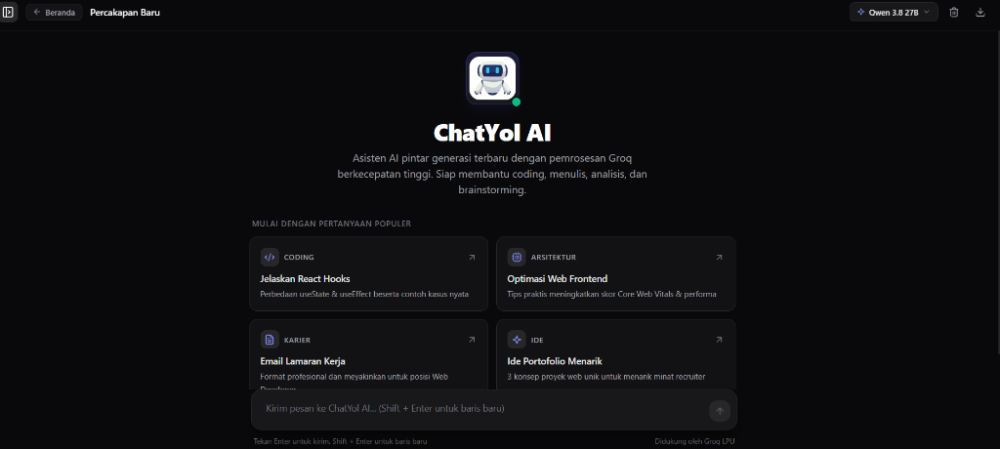
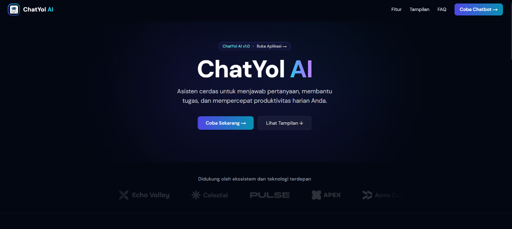
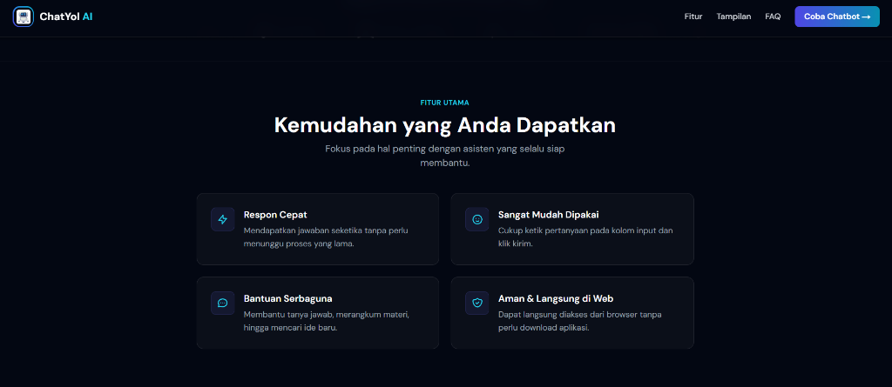
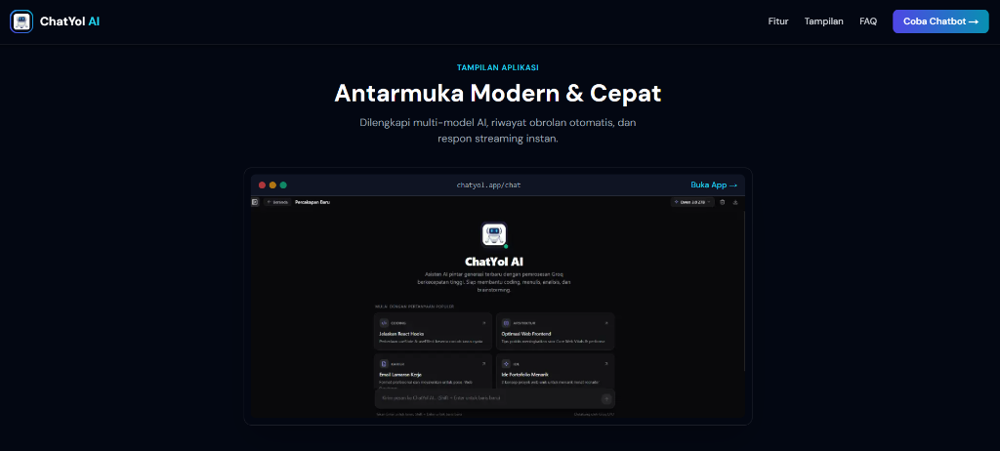
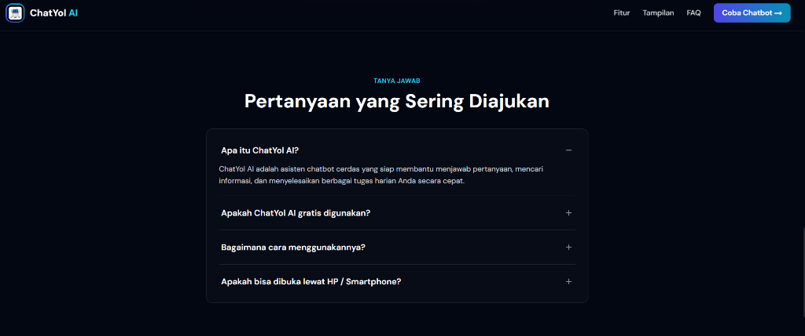

<div align="center">

  

  # 🤖 ChatYol AI — Next.js 14 Workspace & Intelligent Chatbot

  <p align="center">
    <strong>Platform Asisten AI Berkecepatan Tinggi & Landing Page Modern Bertenaga Groq LPU™ Engine</strong>
  </p>

  <p align="center">
    <a href="#-tampilan-antarmuka-preview">Lihat Tangkapan Layar</a> •
    <a href="#-fitur-unggulan">Fitur Utama</a> •
    <a href="#-struktur-proyek">Struktur Proyek</a> •
    <a href="#-panduan-instalasi--menjalankan">Panduan Instalasi</a>
  </p>

  <p align="center">
    
    
    
    
    
    
  </p>

  <br />

  

</div>

<br />

---

## 📖 Tentang ChatYol AI

**ChatYol AI** adalah aplikasi web modern all-in-one yang menggabungkan **Landing Page profesional bertema Dark Mode** dengan **Aplikasi Chatbot Cerdas Berkecepatan Tinggi** dalam satu arsitektur terpadu (**Next.js 14 App Router**). 

Proyek ini telah direfaktor dari arsitektur terpisah menjadi satu repositori terpadu yang efisien, menghilangkan duplikasi konfigurasi dan dependensi, serta dioptimalkan dengan teknik *code-splitting* dan *prefetching* untuk perpindahan halaman yang instan tanpa jeda waktu.

---

## 📸 Tampilan Antarmuka (Preview)

Berikut adalah tangkapan layar langsung dari antarmuka aplikasi ChatYol AI yang sedang berjalan:

### 1. 🏠 Landing Page (Hero & Navigasi)
Tampilan pembuka yang elegan dengan header navigasi sticky, badge versi, headline gradasi, tombol CTA aksi cepat, dan ticker mitra ekosistem.
<p align="center">
  
</p>

### 2. ⚡ Fitur Utama (Kemudahan yang Anda Dapatkan)
Bagian sorotan 4 keunggulan utama sistem: Respon Cepat, Kemudahan Pakai, Bantuan Serbaguna, dan Keamanan Akses Web.
<p align="center">
  
</p>

### 3. 💻 Mockup Showcase Interaktif
Pratinjau antarmuka chatbot asli di dalam frame mockup browser yang dilengkapi tombol langsung untuk mencoba aplikasi.
<p align="center">
  
</p>

### 4. ❓ Tanya Jawab Interaktif (FAQ Accordion)
Informasi lengkap seputar ChatYol AI dengan animasi ekspansi accordion yang halus menggunakan Framer Motion.
<p align="center">
  
</p>

### 5. 🤖 Aplikasi Chatbot Utama (`/chat`)
Antarmuka percakapan interaktif bertenaga Groq LPU™ dengan pemilih model AI, sidebar riwayat multi-sesi, kartu pertanyaan cepat, serta rendering markdown rapi.
<p align="center">
  
</p>

---

## ✨ Fitur-Fitur Unggulan

### ⚡ 1. Respon Streaming Real-Time (Groq LPU™ Inference)
- Jawaban AI mengalir kata per kata secara instan dalam hitungan milidetik (*ultra-low latency*).
- Dilengkapi tombol kendali untuk menghentikan respon (*stop generation*) kapan saja.

### 🧠 2. Pemilih Model AI Fleksibel (Multi-Model Selector)
Pengguna dapat berganti engine model AI secara instan melalui dropdown pada header:
- **`openai/gpt-oss-120b` (Flagship)**: Penalaran tingkat tinggi, logika kompleks, dan analisis komprehensif.
- **`openai/gpt-oss-20b` (Ultra Cepat)**: Ringan, instan, hemat waktu untuk tanya jawab sehari-hari.
- **`qwen/qwen3.8-27b` (Coding & Logic)**: Didesain khusus untuk penulisan kode, debugging, dan analisis teknis.

### 🗂️ 3. Sidebar Riwayat Percakapan (Session Management)
- **Collapsible Drawer**: Sidebar responsif yang dapat dibuka/ditutup untuk memaksimalkan ruang kerja di desktop dan mobile.
- **Penyimpanan Lokal Otomatis**: Seluruh obrolan disimpan di `localStorage` peramban.
- **Judul Sesi Otomatis**: AI otomatis merangkum judul topik percakapan berdasarkan pesan pertama pengguna.
- **Fitur Pencarian**: Pencarian cepat riwayat sesi lama berdasarkan kata kunci.
- **Ekspor Percakapan**: Unduh riwayat obrolan lengkap dalam format Markdown (`.md`).

### 🚀 4. Performa Tinggi & Navigasi Instan
- **Reduksi Bundle 91.5% (250 kB ➔ 21 kB)**: Modul pewarnaan kode (*react-syntax-highlighter*) dimuat secara on-demand (*lazy loading*), menjaga halaman awal tetap ultra-ringan.
- **Prefetching Cerdas (`prefetch={true}`)**: Rute `/chat` di-prefetch secara otomatis di latar belakang saat pengguna berada di landing page sehingga perpindahan terasa instan (0 milidetik).
- **Skeleton Screen Transisi (`loading.tsx`)**: Transisi visual skeleton bertema gelap yang mulus tanpa kedip putih.

---

## 🛠️ Tech Stack & Ekosistem

| Lapisan | Teknologi | Keterangan |
| :--- | :--- | :--- |
| **Framework** | Next.js 14.2 (App Router) | Server-side rendering, client components & routing terpadu |
| **Bahasa** | TypeScript 5 | Tipisasi statis yang aman dan terdokumentasi |
| **Styling** | Tailwind CSS 3.4 | Utilitas styling responsif dengan palet warna dark-mode |
| **Animasi** | Framer Motion 11 | Transisi accordion, glowing hover, dan animasi interaktif |
| **AI Engine** | Groq SDK & Groq LPU™ | Inferensi LLM berkecepatan tinggi dengan streaming token |
| **Paket Manager** | Bun / npm | Manajemen dependensi dan eksekusi skrip cepat |

---

## 📁 Struktur Direktori

```
ChatYol-LandingPage/
├── .env.local                   # Kunci API Groq (NEXT_PUBLIC_CHATYOL / NEXT_PUBLIC_GROQ_API_KEY)
├── public/                      # Aset statis & logo
│   ├── Chatyol.svg              # Logo vektor ChatYol AI
│   ├── Chatyol-ai.png           # Avatar bot ChatYol
│   └── screenshots/             # Tangkapan layar dokumentasi resmi
│       ├── landing-hero.png
│       ├── landing-features.png
│       ├── landing-showcase.png
│       ├── landing-faq.png
│       └── chat-app.png
├── src/
│   ├── app/
│   │   ├── layout.tsx           # Root layout & font DM Sans
│   │   ├── globals.css          # Styling global & scrollbar gelap kustom
│   │   ├── page.tsx             # Halaman Landing Page (/)
│   │   ├── chat/
│   │   │   ├── page.tsx         # Halaman Aplikasi Chatbot (/chat)
│   │   │   └── loading.tsx      # Skeleton screen transisi instan
│   │   └── app/
│   │       └── page.tsx         # Redirect alias (/app -> /chat)
│   ├── components/
│   │   ├── Banner.tsx           # Banner pengumuman atas
│   │   ├── Navbar.tsx           # Header navigasi utama
│   │   ├── Hero.tsx             # Section hero dengan tombol CTA
│   │   ├── Features.tsx         # Section 4 keunggulan utama
│   │   ├── ProductShowcase.tsx  # Frame mockup browser interaktif
│   │   ├── FAQs.tsx             # Accordion tanya jawab interaktif
│   │   ├── CallToAction.tsx     # Section ajakan mencoba di akhir
│   │   ├── Footer.tsx           # Footer informasi hak cipta
│   │   ├── icons/               # Ikon SVG mandiri (bebas dependensi babel)
│   │   └── chat/                # Komponen aplikasi Chatbot
│   │       ├── ChatApp.tsx      # State manager & container chat
│   │       ├── Header.tsx       # Header chat & model switcher
│   │       ├── Sidebar.tsx      # Riwayat sesi percakapan
│   │       ├── ChatMessage.tsx  # Bubble chat user & asisten
│   │       ├── ChatInput.tsx    # Textarea auto-resize & tombol kirim
│   │       ├── WelcomeHero.tsx  # Kartu pertanyaan populer
│   │       ├── MarkdownRenderer.tsx # Parser markdown & on-demand syntax highlighter
│   │       └── Icons.tsx        # Kumpulan ikon UI chat
│   ├── types/                   # Deklarasi TypeScript
│   └── utils/
│       └── groq.ts              # Konfigurasi Groq SDK & streaming logic
└── package.json
```

---

## 🚀 Panduan Instalasi & Menjalankan

### 1. Kloning Repositori & Masuk ke Folder
```bash
git clone <url-repositori-anda>
cd ChatYol-LandingPage
```

### 2. Instalasi Dependensi
Jalankan salah satu perintah berikut:
```bash
bun install
# atau
npm install
```

### 3. Konfigurasi Kunci API (Environment Variables)
Salin `.env.example` menjadi `.env.local`:
```bash
cp .env.example .env.local
```
Lalu isi kunci API Groq Anda di `.env.local`:
```env
NEXT_PUBLIC_CHATYOL=gsk_your_groq_api_key_here
NEXT_PUBLIC_GROQ_API_KEY=gsk_your_groq_api_key_here
```
*(Kunci API Groq gratis dapat diperoleh langsung di [console.groq.com](https://console.groq.com/keys)).*

### 4. Menjalankan Server Pengembangan
```bash
bun dev
# atau
npm run dev
```

Buka peramban di:
- **Landing Page**: [http://localhost:3000](http://localhost:3000)
- **Aplikasi Chatbot**: [http://localhost:3000/chat](http://localhost:3000/chat)

### 5. Membangun untuk Produksi (Build)
```bash
bun run build
# atau
npm run build
```

Jalankan server produksi:
```bash
bun run start
# atau
npm run start
```

---

## 📄 Lisensi
Didistribusikan di bawah lisensi **MIT**. Silakan gunakan dan kembangkan secara bebas untuk keperluan portofolio maupun pengembangan aplikasi lanjutan.
